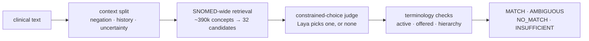

# Clif

**Clif maps clinical free text to SNOMED CT, and says so when it can't.**

You give it `"patient denies chest pain"`. It returns `Chest pain | 29857009`, flags the finding as *negated*, gives a confidence, lists alternatives, and records the SNOMED version it used. When the text doesn't support a code, Clif returns `NO_MATCH`, `AMBIGUOUS` or `INSUFFICIENT_INFORMATION` instead of guessing.

Clif runs entirely on your own hardware. No clinical text leaves the network.



## Why another SNOMED mapper

Most approaches to SNOMED coding pick one of two bad options:

- **A 400,000-class classifier.** It needs huge labelled datasets and fails on concepts it never saw.
- **A generative language model writing codes.** It can hallucinate SCTIDs that don't exist, or valid codes that don't fit.

Clif splits the problem. A fast, recall-oriented search finds about 32 plausible concepts across the whole terminology. A small decision model then chooses among them, with "none of these" and "can't decide" as explicit options. The model can only answer with an option it was offered. Clif maps the answer back to an SCTID itself and rejects anything else, so **an invented code can never reach the output.**

The default judge is [Laya](https://github.com/NandhaKishorM/laya), an open, non-autoregressive decision model (Apache 2.0) that scores all options in one forward pass. Clif ships the tooling to fine-tune it on your SNOMED edition on a single machine.

## Results

Fine-tuned on the SNOMED CT International Edition (October 2026), evaluated on 64 English test phrases with verified codes that were excluded from training:

| | rule-based judge | Laya, untrained | **Laya, fine-tuned** |
|---|---|---|---|
| correct code | 85% | 56% | **91%** |
| unrelated text rejected | 50% | 75% | **100%** |
| ambiguous abbreviations flagged | 100% | 100% | **100%** |
| confidently wrong | 0% | 1.6% | **0%** |
| latency per phrase (median) | 15 ms | 92 ms | 53 ms |

- Retrieval put the correct concept among the candidates in **100%** of cases.
- The fine-tuned judge's remaining misses all returned `NO_MATCH` rather than a wrong code.
- Training needed about 2.5 hours of compute on one Apple M5 Pro laptop: 31,500 examples generated automatically from SNOMED, held-out accuracy 38% → 97.5%.

The test set is small and hand-written. It covers the classic pitfalls (specificity, synonyms, typos, negation, ambiguous abbreviations, non-clinical text), but not the full mess of real clinical notes. See [docs/evaluation.md](docs/evaluation.md) for method, per-case failures and how to reproduce, and measure on your own data before trusting any number here.

## What Clif handles

| | example | behaviour |
|---|---|---|
| specificity | `appendicitis` | *Appendicitis*, never the more specific *Acute appendicitis* |
| synonyms | `heart attack` | *Myocardial infarction* |
| typos | `atrial fibrilation` | *Atrial fibrillation* |
| negation | `patient denies chest pain` | *Chest pain*, `assertion: NEGATED` |
| history | `history of myocardial infarction` | *Myocardial infarction*, `temporality: HISTORICAL` |
| uncertainty | `possible pneumonia`, `V.a. Pneumonie` | *Pneumonia*, `certainty: POSSIBLE` |
| family history | `family history of type 2 diabetes` | `experiencer: FAMILY` |
| abbreviations | `MS` | `AMBIGUOUS` (multiple sclerosis vs. mitral stenosis), resolved by context such as "demyelinating lesions" |
| fixed expressions | `no known drug allergies` | the situation concept *No known drug allergy* |
| multilingual | `Vorhofflimmern`, `Atriumfibrilleren` | *Atrial fibrillation*, with the source and matched description language reported separately |
| hierarchy limits | `appendectomy` + `allowed_hierarchies: ["procedure"]` | only procedures; ECL such as `<< 64572001` is supported |
| non-clinical text | `the weather is lovely today` | `NO_MATCH` |

## Quickstart

No SNOMED licence needed. Clif ships a small hand-built demo release.

```bash
git clone https://github.com/arnepeine/clif && cd clif
uv venv --python 3.12 && uv pip install -e ".[dev]"
clif demo-release data/rf2
python -m clif.import_rf2 data/rf2/SnomedCT_ClifDemoRF2_PRODUCTION_20250101T120000Z
python -m clif.build_index
uvicorn clif.api:app --port 8000
```

```bash
curl -s localhost:8000/map -H 'content-type: application/json' \
  -d '{"text": "patient denies chest pain"}'
```

```json
{
  "status": "MATCH",
  "concept": {"concept_id": "29857009", "preferred_term": "Chest pain",
              "fsn": "Chest pain (finding)", "semantic_tag": "finding"},
  "confidence": 0.9998,
  "alternatives": [{"concept_id": "22253000", "preferred_term": "Pain", "confidence": 0.0001}],
  "assertion": "NEGATED", "temporality": "CURRENT", "certainty": "CERTAIN",
  "source_language": "en", "matched_description_language": "en",
  "snomed_version": "20250101",
  "reranker": {"backend": "heuristic", "model": "bidirectional-coverage-v1"}
}
```

Add `"debug": true` to see every step: the normalized query, each retrieved candidate with its scores, the judge's probabilities, the decision thresholds and the validation checks.

## Using real SNOMED CT

SNOMED CT is licensed. Clif never redistributes it; you import your own copy.

| source | what you get | access |
|---|---|---|
| [Global Patient Set](https://www.snomed.org/gps) | all ~378k active concepts, FSN + one preferred term | free, registration (CC BY-ND 4.0) |
| International Edition | everything: synonyms, hierarchy, language refsets | affiliate licence via MLDS, free in SNOMED member countries |
| national editions | translations, e.g. Germany: >118,000 German concepts | your national release centre |

```bash
export CLIF_DATA_DIR=./data/intl
python -m clif.import_rf2 ~/Downloads/SnomedCT_InternationalRF2_PRODUCTION_20261001T120000Z.zip
python -m clif.build_index
```

The full International Edition imports in about 20 seconds and indexes in about 40 seconds on a laptop. National editions layer on top in the same command. [docs/snomed-data.md](docs/snomed-data.md) explains every source, including how to download through the MLDS API when the web portal is unavailable.

## Fine-tuning the judge

```bash
clif export-laya-training --out data/intl/laya_train.jsonl --n 30000 --negatives 1500 \
  --exclude-eval data/eval/gps_eval_en.json
clif train-laya --data data/intl/laya_train.jsonl --out models/laya-snomed --epochs 2
CLIF_RERANKER=laya-local CLIF_LAYA_CHECKPOINT=models/laya-snomed clif evaluate data/eval/gps_eval_en.json
```

Every SNOMED synonym is a phrase with a known answer. The export runs Clif's real retrieval for each one and stores exactly the question the judge will see in production. The training script is a single-device port of Laya's own training loop, with rolling checkpoints and resume. [docs/fine-tuning.md](docs/fine-tuning.md) covers the method, hardware, timings and the shortcut-learning failure we hit and fixed.

## Documentation

- [Architecture](docs/architecture.md): every pipeline stage and the design decisions behind it
- [API reference](docs/api.md): `/map`, `/map/batch`, `/candidates`, `/concepts/{id}`, `/health`
- [Configuration](docs/configuration.md): all `CLIF_*` settings
- [SNOMED data](docs/snomed-data.md): sources, licences, import
- [Fine-tuning Laya](docs/fine-tuning.md): training data, training, lessons learned
- [Evaluation](docs/evaluation.md): metrics, calibration, results, reproduction
- [Licensing](docs/licensing.md): what you may publish and what you may not

## Judges

The judge is swappable behind one interface (`ConceptReranker.rerank(request) -> RerankResult`):

| `CLIF_RERANKER` | what it is |
|---|---|
| `heuristic` | deterministic token-coverage judge; fast, transparent, the default and the fallback |
| `laya` | [Laya](https://github.com/NandhaKishorM/laya) via `laya-serve` (`POST /v1/systemone`, Jev-compatible) |
| `laya-local` | Laya in-process, e.g. with your fine-tuned checkpoint |
| `llm` | any OpenAI-compatible local LLM (vLLM, llama.cpp, Ollama) with a JSON-schema enum over the options |

## Performance

| | |
|---|---|
| full mapping, rule-based judge (International Edition) | 15 ms median, 35 ms p95 |
| full mapping, fine-tuned Laya judge | 53 ms median, 85 ms p95 |
| serving memory (synthetic full-scale benchmark) | ~1.5 GB |
| startup | < 1 s, indexes are memory-mapped |

## Deployment

`docker compose up -d` starts the API. `docker compose --profile laya up -d` adds a `laya-serve` container built from the pinned Laya release. Both run without internet access once model weights are cached. See [docs/configuration.md](docs/configuration.md).

## Intended use

Clif normalizes terminology. It doesn't diagnose, and it isn't a certified medical device. Use its output where a human reviews codes, or as a pre-coding aid, and validate it on your own documentation before any clinical or billing use.

## Status

Clif is an early release (0.1). The pipeline, API, importers, fine-tuning and evaluation are complete and covered by 109 tests. Still open:

- the evaluation set is small and English-only
- German fine-tuning awaits the national edition
- full ECL support (refinements, member-of) is not implemented yet; unsupported ECL returns a clear 400

Contributions are welcome, see [CONTRIBUTING.md](CONTRIBUTING.md).

## Licence

Code: [Apache License 2.0](LICENSE). SNOMED CT content is not included and remains subject to its own licence. See [NOTICE](NOTICE) and [docs/licensing.md](docs/licensing.md).

SNOMED CT® is a registered trademark of SNOMED International.
