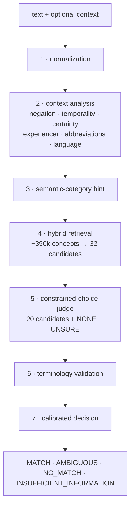

# Architecture

Clif turns one clinical phrase into one SNOMED CT concept, or into an explicit refusal. Every request runs the same seven stages.



The central idea: **retrieval optimizes recall, the judge optimizes precision.** Retrieval may return plenty of wrong candidates as long as the right one is among them. The judge only has to choose among about 20 options, which is a problem a small model can learn, instead of choosing among 390,000 concepts.

## Code map

| stage | module |
|---|---|
| normalization | `clif/text.py` |
| context analysis | `clif/clinical_context/` (`analyzer.py`, `abbreviation.py`, `language.py`, cue lexicons in `clif/resources/*.yaml`) |
| category hint | `clif/retrieval/category.py` |
| retrieval | `clif/retrieval/lexical.py`, `vector.py`, `hybrid.py` |
| judges | `clif/reranking/` (`base.py`, `laya.py`, `heuristic.py`, `llm.py`) |
| validation, decision | `clif/pipeline.py`, `clif/decision.py` |
| terminology | `clif/terminology/` (`rf2.py`, `store.py`, `hierarchy.py`, `sctid.py`), `clif/indexing/build.py` |
| API | `clif/api.py`, `clif/models/schemas.py` |

## 1 · Normalization

The original text is never modified; Clif derives comparison forms from it:

- **`norm`**: Unicode NFKC, casefolded, punctuation replaced by spaces, whitespace collapsed.
- **`folded`**: `norm` with German transliteration (ä → ae, ß → ss) and all remaining diacritics stripped, so `Blinddarmentzundung` finds `Blinddarmentzündung`.

Token comparison is tolerant but medically aware. `soft_token_match` accepts identical tokens, light stems (`allergies` ~ `allergy`), shared roots with short endings (`abdomen` ~ `abdominal`) and small typos. It never equates tokens that end in different meaning-bearing suffixes: `appendicitis` and `appendicectomy` share eight letters and still don't match.

## 2 · Context analysis

Assertions are separated from the concept so that "no chest pain" maps to *Chest pain* plus `assertion: NEGATED`, rather than to a precoordinated negation concept.

**Cue lexicon** (`resources/context_cues.yaml`, English, German, Dutch, French), NegEx/ConText-style:

| attribute | values | example cues |
|---|---|---|
| assertion | `ASSERTED`, `NEGATED` | no, denies, without, ruled out, kein, ohne, ausgeschlossen |
| temporality | `CURRENT`, `HISTORICAL`, `PLANNED` | history of, h/o, status post, Z.n., planned, geplant |
| certainty | `CERTAIN`, `PROBABLE`, `POSSIBLE` | possible, suspected, ?, V.a., probable, likely |
| experiencer | `PATIENT`, `FAMILY` | family history of, Familienanamnese |

- Cues are matched on word boundaries, longest first, in pre and post position.
- Scope terminators (`but`, `aber`, `however`) split clauses; only the first content-bearing clause is mapped, with a warning.
- Leading fillers ("patient has", "complains of", "Patient hat") are removed.
- If nothing concept-bearing remains ("history of"), the result is `INSUFFICIENT_INFORMATION`.

**Fixed expressions** such as "no known drug allergies" are conventionally precoordinated in SNOMED (*No known drug allergy*, a situation). With `CLIF_SITUATION_MODE=fixed_expressions` (default) they are mapped as a whole. Otherwise, once context has been split off, situation concepts are excluded from the candidates so the context isn't encoded twice.

**Abbreviations** (`resources/abbreviations.yaml`) carry a prior per meaning and a list of cue words. Each cue found in the phrase or the surrounding context multiplies the odds of its meaning by 3. An abbreviation resolves only when one meaning reaches 0.9 (`CLIF_ABBREVIATION_DOMINANCE`). Otherwise all plausible expansions are retrieved, and the final status is forced to `AMBIGUOUS` with the posteriors in the reason, for example `MS = multiple sclerosis (0.60) | mitral stenosis (0.40)`.

**Language.** When the caller doesn't pass `language`, a lightweight detector guesses from function words and morphology. Short phrases rarely reveal their language. If the guess isn't confident, Clif searches all indexed languages and reports the language of the description that actually matched.

## 3 · Semantic-category hint

Surface cues (`-ectomy` → procedure, `-itis` → disorder, anatomy-only phrases → body structure) produce a distribution over 16 broad SNOMED categories. Retrieval applies it as a mild multiplicative factor (`CLIF_CATEGORY_WEIGHT=0.15`). It never removes candidates unless hard filtering is enabled and the prediction certainty is above 0.97.

## 4 · Hybrid retrieval

Retrieval runs every query variant (the core text, abbreviation expansions, and the full text in `prefer` situation mode) through these channels:

| channel | how | cost on the International Edition |
|---|---|---|
| exact | index lookup on `norm` | < 1 ms |
| accent-folded exact | index lookup on `folded` | < 1 ms |
| prefix | index range scan | < 1 ms |
| BM25 | SQLite FTS5: a selective AND query first; an OR query over discriminative tokens only if AND is thin (tokens in > 2% of descriptions are left out) | a few ms |
| spelling correction | tokens missing from the term vocabulary are corrected against it with rapidfuzz, then the corrected query re-runs all lexical channels | a few ms |
| vector | cosine over memory-mapped embeddings: hashing (default, no model), sentence-transformers or an HTTP embedding service; FAISS if installed | ~10 ms |

Descriptions are then grouped by concept. Each concept keeps its best description per signal, and the scores combine as

```
retrieval_score = (0.40 · lexical + 0.35 · semantic + 0.15 · exact_bonus + 0.10 · terminology_prior)
                  × category_factor
```

- Weights are configurable and renormalized when vector search is off.
- The prior favours clinical hierarchies over metadata and navigational concepts.
- Inactive concepts, concepts outside the caller's hierarchy or ECL constraint, and excluded situation concepts are filtered with a recorded reason.
- The top 32 concepts are kept, and results are cached per query in an LRU.

The first design used a trigram FTS index for fuzziness. At full scale a trigram OR-query touched hundreds of thousands of rows (~200 ms), so it was replaced by vocabulary spelling correction, which brought retrieval p50 from 125 ms to 24 ms on a 1.4M-description benchmark.

## 5 · Constrained-choice judge

The top 20 candidates (`CLIF_RERANK_CANDIDATES`) become a closed question. Each candidate carries its preferred term, FSN, semantic tag, up to six synonyms, parent concepts and the description that retrieval matched. `NO_MATCH` and `AMBIGUOUS` are always offered as options.

Every judge implements one interface:

```python
class ConceptReranker:
    def rerank(self, request: RerankRequest) -> RerankResult: ...
```

`RerankResult` holds a probability per offered concept plus `no_match` and `ambiguous`. The shared helper `result_from_label_scores` maps answer labels back to SCTIDs and **rejects anything that wasn't offered**. A rogue judge returning an unknown SCTID is covered by a test.

### Laya specifics

[Laya](https://github.com/NandhaKishorM/laya) reads option labels as text, so Clif adapts the question to how Laya works:

- **Preferred terms as labels.** Labels are made unique, and boolean-like terms ("Yes", "No") get their semantic tag appended, following Laya's documented limits.
- **Matched description first.** The term retrieval matched (e.g. "Herzinfarkt") leads each option's description, so the model compares like with like instead of translating.
- **Per-request token budget.** All options share one `head_max_len` token budget. Clif sizes it per request from the rendered options (256 to 1024 tokens). If Laya still reports collapsed options (`usage.options`), the result is forced to `AMBIGUOUS`.
- **Core text only.** Laya never sees negation cues ("chest pain", not "patient denies chest pain"), because its documentation reports weaknesses on negated input.
- **Checkpoint by language.** German or Dutch input goes to the `multilingual` checkpoint, English to `english`.
- **Two transports.** Clif talks to Laya over HTTP (`laya-serve`, `POST /v1/systemone`) or in-process (`laya-local`). In-process batch requests use Laya's batched forward passes.

### Other judges

- **`heuristic`:** bidirectional soft token coverage. Recall measures how much of the phrase a candidate covers; precision measures how much of the candidate the phrase supports, and low precision means unsupported detail such as "acute". Deterministic, about 1 ms, the default and the fallback.
- **`llm`:** any OpenAI-compatible local server with a JSON-schema enum over the option labels. The distribution comes from token logprobs when available; otherwise the self-reported confidence is used and flagged as not a probability.
- **`FallbackReranker`:** wraps a primary judge; on failure the heuristic answers and the response is flagged `fallback_used`.

## 6 · Terminology validation

After the judge answers, every scored concept must pass these checks:

1. it was offered in the candidate set,
2. it is active,
3. it satisfies the caller's `allowed_hierarchies` / `ecl` constraint,
4. the description it was matched through is active.

Failures are removed and recorded in `debug.validation`.

**Hierarchy constraints** are evaluated as predicates over cached ancestor sets, so `<< 404684003` (hundreds of thousands of descendants) is never expanded. The ECL subset covers `<<`, `<`, `<!`, `>>`, `>`, `>!`, `*`, `AND`, `OR`, `MINUS` and parentheses. Refinements and member-of raise a clear 400 instead of being ignored. Releases without relationships (the Global Patient Set) fall back to semantic tags for named hierarchies and refuse ECL.

## 7 · Calibrated decision

Raw model probabilities aren't treated as calibrated confidence.

- A Platt calibrator over the judge probability, retrieval score and margin can be fitted on a validation set (`clif evaluate --calibrate`). Until then responses report `calibrated: false`.
- Statuses follow configurable thresholds:

| status | condition |
|---|---|
| `MATCH` | calibrated top confidence ≥ `threshold_match` (0.60) and margin to second ≥ `threshold_margin` (0.20) |
| `NO_MATCH` | judge chose NONE, or top confidence < `threshold_no_match` (0.30), or no candidate survived |
| `AMBIGUOUS` | judge chose UNSURE, close competitors, an unresolved abbreviation, collapsed options, or confidence between the thresholds |
| `INSUFFICIENT_INFORMATION` | nothing concept-bearing after context analysis |

The calibration step also grid-searches the thresholds that maximize correct matches minus four times the wrong matches. A wrong code is treated as four times worse than no code.

## Storage

Everything lives in one SQLite file plus one memory-mapped vector matrix. There's no search server and no database service.

| table | content |
|---|---|
| `concepts`, `descriptions`, `relationships`, `langrefset` | raw RF2 rows, upserted by component id keeping the newest `effectiveTime` (works for Snapshot, Full, Delta and layered editions) |
| `concept_meta`, `concept_pt` | active concepts with FSN, semantic tag, preferred term per language |
| `is_a` | active inferred IS-A edges between active concepts |
| `search_terms` + `fts_terms` + `fts_terms_vocab` | every searchable active description with normalized forms, the FTS5 BM25 index, token document frequencies |
| `meta` | SNOMED version, edition, index schema version |

The runtime refuses an index built with a different schema version and tells you to rerun `build_index`. SCTIDs are stored as text throughout and are never converted to numbers.

## Audit trail

Every response contains:

- the untouched input
- `snomed_version` and `snomed_edition`
- the judge backend and model
- whether a fallback was used
- the assertion attributes and the decision reason

With `debug: true` it also contains the full trace: normalized queries, cue spans, abbreviation posteriors, every candidate with channel scores, filtered concepts, judge probabilities, thresholds, validation checks and per-stage timings.
